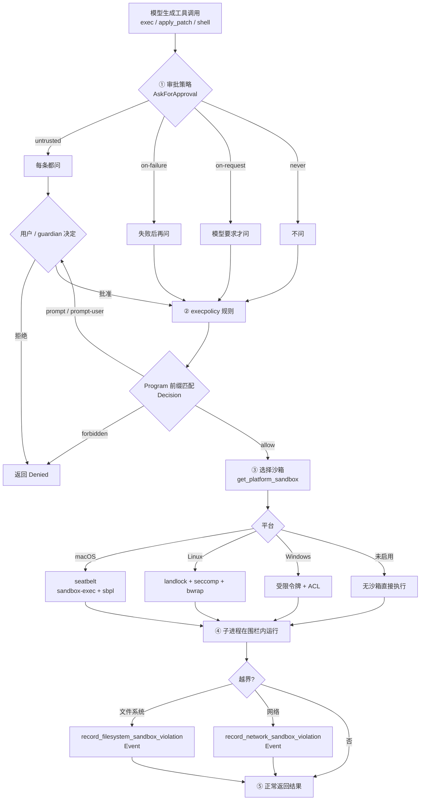
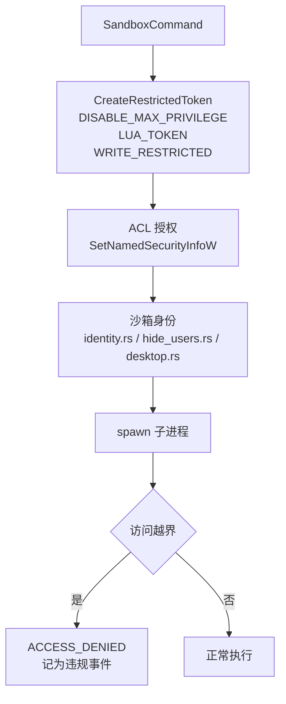

# codex 安全围栏梳理

> 状态：已归档（2026-11-17）：定点快照，引用前先回源核对。

基于 `D:\codex\codex` 源码（HEAD `748ab55ca7`），只读检查，未改任何代码。

## 一句话

codex 的围栏是**进程权限级强制**：先在应用层做审批和前缀规则，再把命令丢进操作系统的沙箱（受限令牌 / seatbelt / landlock），子进程越界时由内核直接返回 `ACCESS_DENIED`。

## 总流程



## 各层证据

### ① 审批策略 `AskForApproval`

- 定义：`codex-rs/core/src/tools/approvals.rs:39`
- 四种取值对应「什么时候弹审批」：`untrusted`（每条都问）、`on-failure`（失败后再问）、`on-request`（模型要求才问）、`never`（不问）
- 决策产物：`ReviewDecision`（`approvals.rs:42`，`Approved` / `Denied` / `TimedOut` / `Abort`）
- 审批缓存：`ApprovalCacheKey`（`approvals.rs:169`），同一命令不重复问

### ② execpolicy 前缀规则

- 规则模型：`PrefixRule` / `PrefixPattern` / `PatternToken`（`codex-rs/execpolicy/src/rule.rs`）
- 策略入口：`Policy` / `Evaluation` / `MatchOptions`（`codex-rs/execpolicy/src/policy.rs:28-32`）
- 四档结论：`codex-rs/execpolicy/src/decision.rs:9-19` —— `allow` / `prompt` / `prompt-user` / `forbidden`
- 规则来源：`.rules` 文件 + 运行时追加（`amend::blocking_append_allow_prefix_rule`、`blocking_append_network_rule`，`execpolicy/src/lib.rs:12-13`）

**边界**：前缀匹配只看程序名和参数形状，不看语义。变量展开、脚本内容一律看不见——这和 dsc 的 `execpolicy.ts` 是同一种思路，也是同一种盲区。

### ③ 沙箱选择 `get_platform_sandbox`

`codex-rs/sandboxing/src/manager.rs:48-62`：

```rust
if macos      { Some(SandboxType::MacosSeatbelt) }
else if linux { Some(SandboxType::LinuxSeccomp) }
else if windows {
    if windows_sandbox_enabled { Some(SandboxType::WindowsRestrictedToken) }
    else { None }
}
```

`SandboxType` 五种：`None` / `MacosSeatbelt` / `LinuxSeccomp` / `WindowsRestrictedToken` / `WindowsMxc`（`codex-rs/protocol/src/sandbox.rs:29-35`）。

**关键**：Windows 上如果没启用沙箱，`get_platform_sandbox` 返回 `None`，整条围栏消失。dsc 的 `danger-full-access` 等价于这个 `None`。

### ④ 平台强制

**Windows**（`codex-rs/windows-sandbox-rs/`）：



- 受限令牌：`windows-sandbox-rs/src/token.rs:21`，三个标志位在 `token.rs:42-44`
- ACL 操作：`windows-sandbox-rs/src/acl.rs`（`SetNamedSecurityInfoW`）
- 读禁：`deny_read_acl.rs` / `deny_read_resolver.rs` / `deny_read_state.rs`
- 身份隔离：`identity.rs`、`hide_users.rs`、`desktop.rs`
- MXC 后端：`codex-mxc-sandbox`（`sandboxing/src/lib.rs:26-28`）

**macOS**：seatbelt，`sandbox-exec` 加载 sbpl 策略（`codex-rs/sandboxing/src/seatbelt.rs:21`），默认 deny。

**Linux**：`landlock.rs` + seccomp 过滤器 + `bwrap.rs`（bubblewrap），`sandboxing/src/lib.rs:1-2,4-5`。

### ⑤ 违规与回传

- 事件类型：`FileSystemSandboxViolation` / `NetworkSandboxViolation` / `SandboxViolationBackend`（`sandboxing/src/lib.rs:50-57`）
- 记录入口：`record_filesystem_sandbox_violation`、`record_network_sandbox_violation`、`record_sandbox_violation`
- 网络侧：`NetworkProxy` / `ManagedNetworkSandboxContext`（`manager.rs:12-13,107`），走专用代理 + 白名单

## 和 dsc 的差别

| 维度 | codex | dsc |
|---|---|---|
| 强制点 | 内核 / ACL / 受限令牌 | 进程内静态解析（`enforcement: partial`） |
| 变量展开 | 不影响，权限本身不够 | 解析不出 `$home` 的实际值 |
| 关掉围栏 | Windows 未启用沙箱时 `None` | `danger-full-access` 直接放行（`policy.ts:631`） |
| 审批 | 四档 `AskForApproval` + 四级 `Decision` | 三档 + 命令规则表 |

那次事故正好落在两边的共同盲区：档位是 `danger-full-access`（等于 codex 的 `None`），命令又是变量引用的脚本。
