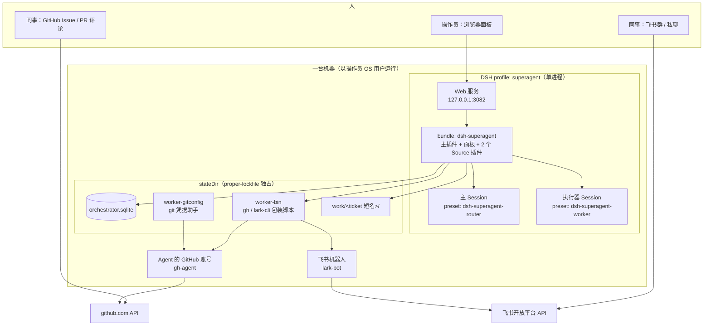
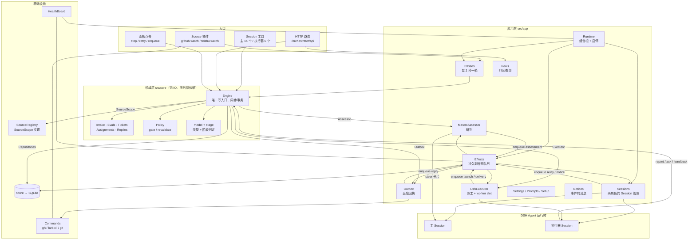
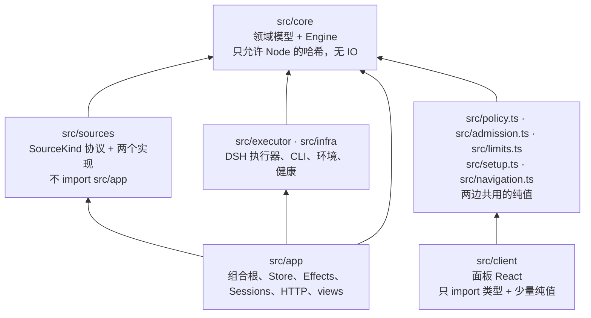
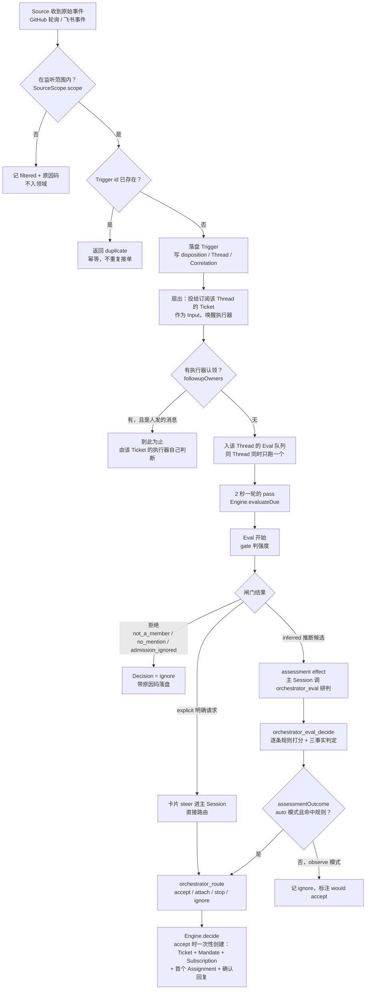
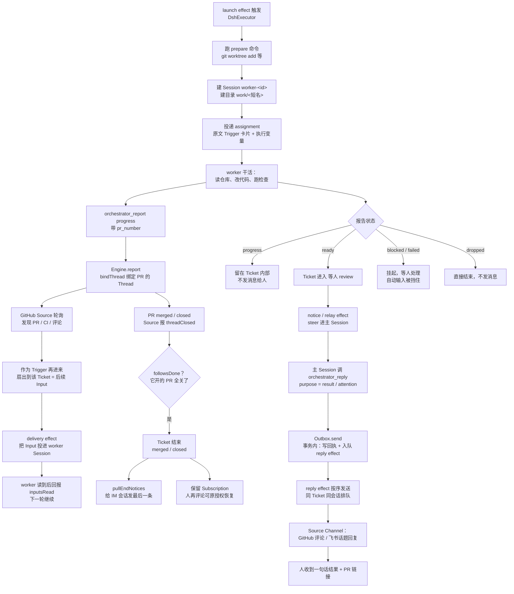
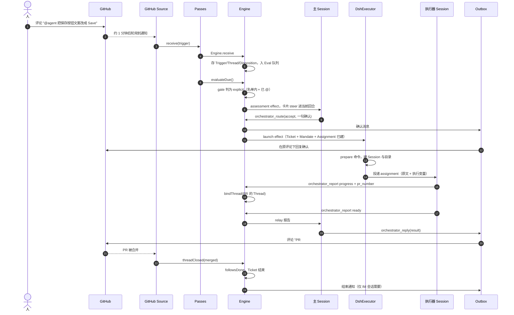
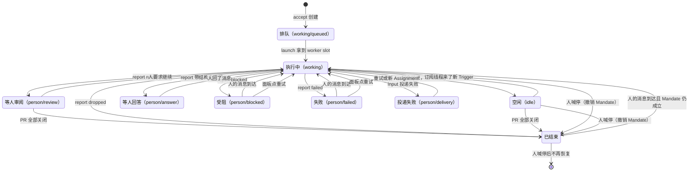
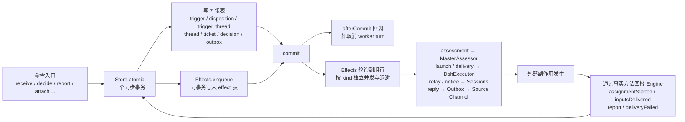

# dsh-superagent 架构图与数据流图

<!-- docs-check:ignore-file: 整篇描述上游原型仓库 D:\code\dsh-superagent-prototype，文中 文件:行号 都是相对那个仓库根，本仓没有这些文件，属整篇外来内容 -->

> 阅读对象：`D:\code\dsh-superagent-prototype`（研究原型，单提交）。
> 本文的图用 Mermaid 语法书写，需要支持 Mermaid 的查看器（VS Code + Markdown Preview Mermaid、Typora、GitHub、Obsidian 均可）。当前 DSH Web 面板不渲染 Mermaid。
> 文中 `文件:行号` 都是相对仓库根目录的定位。

---

## 图 1 · 部署图：谁跑在哪

一句话：**一个 DSH profile、一个进程、一个 SQLite 文件、一个独占锁**；Agent 用独立 GitHub 账号和独立飞书机器人身份对外说话。

关键落点：

- bundle 插入三个插件、两个 preset：`cordis.patch.yml:4`、`:20`、`:125`
- 状态目录加锁、开库：`src/app/runtime.ts:91-98`
- 命令包装与 git 配置由 setup 写入：`docs/006-deployment.md:222-227`
- **注意**：这些包装只是默认值，不是安全边界；worker 以 `danger-full-access` 跑，能用绝对路径绕过（`docs/006-deployment.md:19`）。

---

## 图 2 · 组件架构图：进程内的零件怎么连

一句话：`Runtime` 是组合根，`Engine` 是唯一领域写入口，所有外部动作都经**端口（ports）**入队、由适配器在事务提交后执行。

关键落点：

- 装配顺序与依赖注入：`src/app/runtime.ts:96-166`
- Engine 的 5 个内部部件与单向依赖：`src/core/engine.ts:24-38`、`docs/007-architecture.md:52-60`
- 角色接口收窄（调用者只拿到自己的 `Pick`）：`src/core/engine.ts:261-270`
- 端口定义：`src/core/ports.ts:17-83`

---

## 图 3 · 分层依赖图：谁能 import 谁

一句话：**领域层不碰世界，来源层不碰应用层，面板只拿类型**。这是全仓库最硬的纪律。

规则写在 `docs/007-architecture.md:257-259`。配套的「一个状态一个写者」表在 `:259-271`：Trigger/Thread/Ticket/Decision/Assignment 只有 Engine 写，Settings 只有 Settings 写，回执只有 Outbox 写。

---

## 图 4 · 数据流（上）：一条 Trigger 进来之后

一句话：**先过滤、再去重、然后落盘并扇出；只有「没有执行器认领」的 Trigger 才进入 Eval。**

关键落点：

- 过滤与去重、扇出、入队：`Intake.receive`，`src/core/intake.ts:19-62`；判断「是否还有执行器认领」在 `:58`
- 闸门：`gate()`，`src/policy.ts:191-211`；强度三档的完整表在 `docs/002-authorization.md:48-52`
- 研判转结论：`assessmentOutcome()`，`src/policy.ts:40`；`admitsInferred` 在 `:212`
- 一轮 pass：`Passes.pumpOnce`，`src/app/passes.ts:63-68`

---

## 图 5 · 数据流（下）：接单之后，结果怎么回到人

一句话：**worker 只写领域事实，主 Session 只负责把话送到原来的对话，出站统一走 Outbox 回执 + 重试。**

关键落点：

- 报告与结束判定：`Engine.report` 的注释写清了 `ready`/`dropped`/`followsDone` 三种结局，`src/core/engine.ts:230-239`
- 回执与发送原子性：`Outbox.send` 在同一个事务里写回执并入队，`src/app/outbox.ts:26-31`；「同一 Ticket 同一会话必须排队」在 `:44-45`
- 回复目的四分法：`acknowledgement` / `answer` / `result` / `attention`，`src/core/ports.ts:72`
- 结束通知：`pullEndNotices`，在 Runtime 的 `emit` 里挂接，`src/app/runtime.ts:148-152`

---

## 图 6 · 时序图：一次「@agent 改个按钮」到 PR 合并

把图 4 和图 5 压成一条时间线，标了每一步的触发源。

时间尺度参考：轮询 1 分钟、pass 2 秒、出站重试从 5 秒翻倍到 300 秒（`docs/003-execution.md:177`、`docs/007-architecture.md:174-179`）。

---

## 图 7 · Ticket 状态机

一句话：**状态不是执行器上报的，而是从「最新 Assignment 的报告 + 有没有等人的东西」推导出来的**（`ticketStage`，`src/core/stage.ts:9-21`）。判定顺序从上往下，第一个命中为准。

两个容易看错的点：

- **「等人 review」不等于「等人回答」**：前者是 `ready` 报告，后者是有结构化问题（`attention`）。
- **已结束的 Ticket 保留 Subscription**：人再评论可以**用原授权直接恢复**，不需要重新走 Eval；但被「人喊停」的除外（`docs/002-authorization.md:127-129`）。

---

## 图 8 · 写路径：一条命令怎么落库、副作用怎么出去

这是整套架构最关键的一张，也是它和其他 Agent 项目最大的区别：**事务里只写库和入队，绝不发网络请求**。

关键落点：

- 事务边界与「端口在事务内入队、适配器在提交后执行」：`docs/007-architecture.md:166-170`
- 六种 effect 的并发上限与重试表：`docs/007-architecture.md:174-179`
- 命令命名规范：请求用祈使句（`stopTicket`），适配器事实用过去式（`assignmentStarted`），`docs/007-architecture.md:272`

---

## 三句话收尾

1. **架构上是六边形**：`Engine` 在中心，`Repositories / Policy / SourceScope / Assessor / Executor / Outbox` 六个端口朝外，所有外部世界的东西都挂在端口上（`src/core/ports.ts:105-134`）。
2. **数据流是两条**：一条「事件进来 → 判要不要干」（图 4），一条「授权出去 → 干完回话」（图 5）；两条只在 `Ticket` 这一个对象上会合。
3. **可靠性靠「先存后做」**：每个外部动作在事务里先落一行 effect 或回执，提交后才执行，失败按 kind 退避重试（图 8）。所以进程崩了，活还在。
